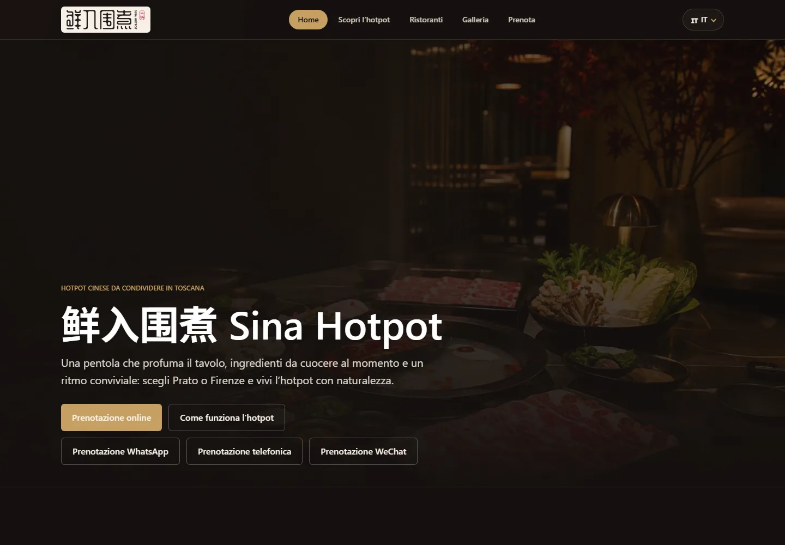

# Sina Hotpot

Website for Sina Hotpot, a Chinese hotpot restaurant in Prato and Firenze, Italy.

Live: [sinahp.com](https://sinahp.com/)



## What it is

A production site for a real restaurant in Tuscany: five languages (Italian, Chinese, English,
Spanish, French), a hotpot culture guide, location pages, a photo gallery, and an online
reservation form. It's the live site the restaurant uses.

There's no CMS or database. All the content lives in typed TypeScript files, so if a
translation or a field is missing, the build fails instead of shipping a broken page.

## Stack

- Astro 6 (static output)
- TypeScript, strict mode
- Tailwind CSS v4
- Cloudflare Workers + Wrangler
- Web3Forms for reservations, hCaptcha optional
- Google Ads conversion tracking, consent denied by default

## How I built it with AI

I did this solo while learning Astro from the official tutorial and docs. Codex and Claude Code
wrote most of the code. I decided what to build, wrote the requirements, reviewed the diffs, and
tested the result.

What helped:

- **Learning the basics first.** I read the Astro docs before asking an agent to build
  anything. I picked Tailwind because its class names are explicit, which makes AI-generated
  markup easier to review.
- **Giving the agents context.** `CLAUDE.md` describes the project structure, commands, and
  conventions, so Claude Code doesn't start from zero every session. For Codex I added the
  Astro Docs MCP server in `.codex/config.toml`, so it reads the current docs instead of
  guessing.
- **Describing the business, not the code.** I wrote requirements like "adding a language
  shouldn't mean editing every page" or "a new location should update hours, schema, and
  reservation slots." The agents suggested structures; I picked what fit.
- **Small iterations.** Plan, build, run `npm run build`, check desktop and mobile, commit.
  About 80 commits. When something was wrong, I described the behavior instead of asking for a
  rewrite.

The agents were fast at writing code. They couldn't decide what a restaurant needs, whether the
copy sounded right, or whether the layout felt good on a phone. That part was mine.

## Project structure

- `src/data/routing.ts` defines languages, page slugs, and URL helpers. No hardcoded URLs.
- `src/data` holds restaurant info, copy, culture articles, gallery groups, and SEO metadata.
- Italian pages are files in `src/pages`; other languages are generated by
  `src/pages/[locale]/[...slug].astro`.
- `src/layouts/SiteLayout.astro` is the only HTML shell: SEO tags, hreflang, JSON-LD, header,
  footer, cookie banner.
- Images in `src/assets` are optimized at build time. `public/` only has raw files.
- Client-side JS is a few small scripts in `src/scripts`. No client framework.

One known tradeoff: opening hours are written in three places in `restaurant.ts` (display
text, schema.org, reservation slots), so they have to be updated together.

## Run it locally

Needs Node 22.12 or newer.

```bash
git clone https://github.com/lorenzoyang/sinahp2.git
cd sinahp2
npm install
cp .env.example .env
npm run dev
```

On Windows, use `copy .env.example .env`.

| Variable | Purpose |
| --- | --- |
| `PUBLIC_WEB3FORMS_ACCESS_KEY` | Web3Forms key for the reservation form. It's a public client key, so it ends up in the built HTML. |
| `PUBLIC_WEB3FORMS_CAPTCHA_ENABLED` | `true` to require hCaptcha (default `false`) |

Both are read at build time through `astro:env/client` in `ReservationForm.astro` and declared in
the `env` schema in `astro.config.mjs`. Without the key, the site still builds and runs; the form
just refuses to submit. Because the output is static, the values are baked into the HTML during
the build, so whatever runs the build needs them — changing them later requires a rebuild.
Web3Forms keys are designed to be public.

| Command | What it does |
| --- | --- |
| `npm run dev` | Dev server |
| `npm run check` | Astro and TypeScript diagnostics |
| `npm run build` | Diagnostics plus production build |
| `npm run preview` | Build and preview with Wrangler |
| `npm run deploy` | Build and deploy to Cloudflare |

## What's missing

No automated tests and no linter. `npm run build` is the only check, plus manual testing in the
browser. If I keep working on it, I'd add Playwright smoke tests, a CI workflow, and
server-side form handling instead of posting to Web3Forms from the browser.

## Credit

Built by [@lorenzoyang](https://github.com/lorenzoyang), with Codex and Claude Code as coding
assistants.

The Sina Hotpot brand, photos, and restaurant copy belong to Ristorante Sina Hotpot S.r.l. The
code is public as a portfolio example.
